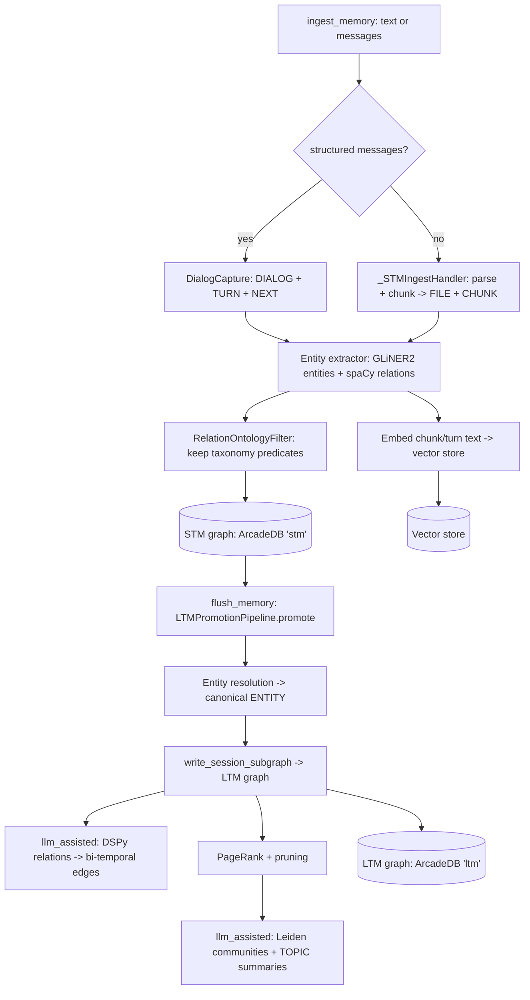
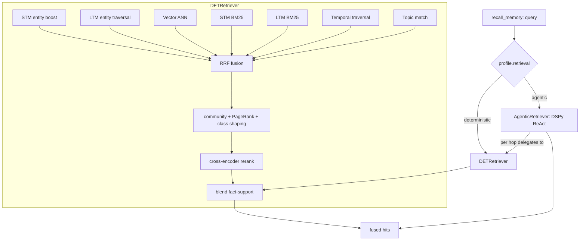

# Architecture

graphknows is an agentic memory system. It ingests conversations and documents,
builds a knowledge graph over [ArcadeDB](https://arcadedb.com), and serves hybrid
retrieval to an agent. This document traces the moving parts and where each lives.

## Public entry point

Everything is reached through `GraphKnowsRuntime` (`graphknows/runtime.py`), a
transport-neutral, async runtime. It is wrapped by the MCP stdio server
(`graphknows/mcp/`) and the web server (`graphknows/web/server.py`), but the class
is usable directly:

```python
from graphknows import GraphKnowsRuntime

async with GraphKnowsRuntime() as rt:
    await rt.ingest_memory(messages, session_id="s1")
    await rt.flush_memory("s1")
    hits = await rt.recall_memory("who did Caroline meet?", session_id="s1")
```

Async methods on the runtime:

| Method | Purpose |
| --- | --- |
| `ingest_memory` | Ingest text or a message list into short-term memory (STM). |
| `recall_memory` | Ranked hybrid recall over STM/LTM; returns fused hits. |
| `flush_memory` | Promote one session's STM subgraph into long-term memory (LTM). |
| `purge_memory` | Delete STM and/or LTM (all, or one session). |
| `stats` | Node counts per database. |
| `doctor` | Backend connectivity check (`stm` / `ltm` databases). |
| `corpus_ingest` | Batch-ingest documents through the corpus workflow (`graphknows/memory/workflows/corpus_ingest.py`). |

## Configuration and modes

Config is `GraphKnowsSettings` (`graphknows/config/__init__.py`), a
`pydantic-settings` model. Every field maps to a `GRAPHKNOWS_`-prefixed
environment variable (also read from a `.env` file). Key ones:
`GRAPHKNOWS_MODE`, `GRAPHKNOWS_ARCADEDB_URL`, `GRAPHKNOWS_LLM_MODEL`,
`GRAPHKNOWS_LLM_API_KEY`, `GRAPHKNOWS_EMBED_MODEL`, `GRAPHKNOWS_EMBED_API_BASE`,
`GRAPHKNOWS_ONTOLOGY_FILE`.

`GRAPHKNOWS_MODE` (enum `MemoryMode`) is the single switch that governs both
extraction and retrieval. `get_profile(settings)` in `graphknows/config/profiles.py`
is the **single source of truth** for mapping mode to capabilities; all branching
derives from the returned `MemoryProfile`, never from `settings.mode` directly.

| Mode | Extraction | Retrieval | Schema | API keys |
| --- | --- | --- | --- | --- |
| `llm_free` (default) | GLiNER2 entities + spaCy relations | `DETRetriever` (deterministic, RRF fusion) | flat taxonomy | none |
| `llm_assisted` | DSPy LLM relation extraction, RDF/OWL ontology | `AgenticRetriever` (DSPy ReAct) | injectable RDF ontology | LLM + optional embed |

Embeddings default to a local `sentence-transformers` model, so `llm_free` runs
with zero API keys.

## Memory model: STM to LTM

The system has two ArcadeDB databases, `stm` and `ltm`, and a promotion pipeline
between them.

### Short-term memory (STM)

STM is a per-session evidence graph built at ingest time. `ingest_memory` routes
to `STMService` (`graphknows/memory/stm/service.py`):

- A structured message list goes through `ingest_messages` → `DialogCapture`,
  creating `DIALOG` / `TURN` nodes with `HAS_TURN` and `NEXT` (turn sequence) edges.
- Plain text goes through `ingest` → `_STMIngestHandler`
  (`graphknows/memory/stm/ingest.py`): the text is parsed and chunked, producing
  `FILE` and `CHUNK` nodes with `HAS_CHUNK` edges.

Either way, an entity extractor runs on each unit of text and writes `ENTITY`
nodes plus `MENTIONS` edges (chunk→entity) or `HAS_ENTITY` edges (turn→entity).
In `llm_free` mode the extractor is GLiNER2 for entities and a spaCy
dependency-pattern relation extractor; extracted relations are passed through a
`RelationOntologyFilter` seeded with the default taxonomy's relation types
(`graphknows/ingestion/domain/taxonomy.py`), dropping any label outside the
controlled vocabulary. Chunk text and embeddings are written to the vector store
in parallel.

STM node/edge types: `SESSION`, `FILE`, `CHUNK`, `DIALOG`, `TURN`, `ENTITY`;
edges `IN_SESSION`, `HAS_CHUNK`, `MENTIONS`, `HAS_TURN`, `NEXT`, `HAS_ENTITY`.

### Promotion / flush (STM → LTM)

`flush_memory(session_id)` runs `LTMPromotionPipeline.promote`
(`graphknows/memory/flush.py`). The pipeline reads the session subgraph out of
STM and MERGEs it into LTM. In order:

1. **Read STM subgraph** and snapshot it (`SessionSnapshot`).
2. **Entity resolution** (`graphknows/memory/ltm/entity_resolution.py`,
   `EntityResolution.resolve`): group entities case-insensitively, keep the
   highest-confidence spelling as canonical, and remap alias names in chunk/turn
   edges so ArcadeDB does not split one entity into two nodes. Returns a
   `PromotionAudit`.
3. **Write LTM graph** (`ltm_store.write_session_subgraph`): MERGE `SESSION`,
   `FILE`, `CHUNK` (with `session_id` stored on the node), canonical `TEMPORAL`
   nodes (`MENTIONS_DATE`), `ENTITY`, `DIALOG`, `TURN`, and the `NEXT` sequence.
   In `llm_assisted` mode, `extract_and_write_relations` additionally runs the
   DSPy relation extractor over the largest chunks (capped at 10 to bound LLM
   latency) and writes typed relation edges.
4. **Copy vector rows** STM→LTM (`promote_to_ltm`).
5. **Index entities**: embed entity names and upsert into the vector store so the
   entity-graph retrieval path has live data.
6. **PageRank / centrality** (`compute_and_persist_pagerank`): a lightweight
   in-process power-iteration PageRank over the entity-relation graph, persisted
   onto `ENTITY` nodes (both modes).
7. **Graph pruning**: `prune_tombstoned_edges` / `prune_duplicate_edges`.
8. **Community detection** (`_run_gds`) — gated to `llm_assisted` by policy —
   optional Leiden communities, writing `community_id` onto entities.
9. **Topic summarization** (`_run_topics`): `TopicSummarizer`
   (`graphknows/memory/ltm/topic_summarizer.py`), a DSPy module, writes `TOPIC`
   nodes with an LLM-generated title + grounded summary. Requires an LLM key.
10. **Community metadata** write-back, then optional **STM clear**.

**Bi-temporal relation edges.** Relation edges carry `valid_at` (world time),
`invalid_at` (tombstone), `created_at` (ingestion time), and `is_current`. For
single-valued predicates a supersedence pass (`_supersede_ltm_edge`) tombstones
any existing current edge that points at a different target — setting
`invalid_at` and `is_current = false` rather than deleting it — preserving history.

LTM adds these types over STM: `TOPIC`, `TEMPORAL`; edges `MENTIONS_DATE`, plus
the extracted typed relation edges between `ENTITY` nodes.

## Storage: ArcadeDB

ArcadeDB is reached through a thin async httpx client, `ArcadeDBClient`
(`graphknows/memory/stores/arcadedb/client.py`), which wraps the ArcadeDB REST
API (query, command, transactions) with HTTP Basic Auth. Three stores sit on top,
all in `graphknows/memory/stores/arcadedb/`:

- `stm_store.py` — the STM session evidence graph (database `stm`).
- `ltm_store.py` — the LTM knowledge graph (database `ltm`); owns the flush
  write-path, PageRank, pruning, and relation extraction.
- `vector_store.py` — chunk/entity embeddings and ANN search.

Note: LTM flush writes are auto-committed per element rather than wrapped in one
transaction — the flush runs in a worker-thread event loop while the client is
bound to the server's main loop, so a begin/commit pair would land on different
connections and ArcadeDB would silently discard the writes.

## Embeddings

`graphknows/memory/stores/embedder.py` provides `embed` / `embed_one` (LRU-cached)
and a `get_embedder` shim. By default a local `sentence-transformers` model
(`BAAI/bge-small-en-v1.5`, 384-dim) runs in-process on CPU — no API key. Setting
`GRAPHKNOWS_EMBED_API_BASE` routes embeddings through a remote OpenAI-compatible
`/embeddings` endpoint instead (model and key from `GRAPHKNOWS_EMBED_MODEL` /
`GRAPHKNOWS_EMBED_API_KEY`). There are no silent embedding fallbacks — errors
propagate.

## Retrieval

`recall_memory` builds a retriever lazily (`_get_retriever`), choosing by profile.

### DETRetriever (llm_free)

`DETRetriever` (`graphknows/memory/query/retriever.py`) is a deterministic hybrid
retriever. It runs seven collectors concurrently, each returning candidate chunks
scored by reciprocal-rank:

- `_stm_entity_boost` — STM entity-graph traversal
- `_ltm_entity_traversal` — LTM entity-graph traversal
- `_semantic_ann` — vector ANN over embeddings (with an optional declarative
  query variant)
- `_stm_bm25` / `_ltm_bm25` — full-text (BM25) search in each database
- `_ltm_temporal_traversal` — temporal / date-anchored traversal
- `_ltm_topic_match` — topic-node match

Candidates are fused by **RRF** (reciprocal-rank fusion), then shaped by
community boost, PageRank boost, and memory-class weighting before sorting. A
local cross-encoder **reranker** (`graphknows/memory/query/rerank.py`,
`BAAI/bge-reranker-base`) refines the pool; it is a no-op pass-through when the
model or `sentence-transformers` is unavailable. Finally a unified **fact-support**
term is blended into the normalised rerank score: a canonical fact whose subject
the query names and which points at a chunk via provenance lifts that chunk. The
term self-attenuates to 0 when no fact matches, so vector relevance dominates
inference queries with no router needed. A per-query `trace` records how each
surviving candidate scored per signal.

### AgenticRetriever (llm_assisted)

`AgenticRetriever` (`graphknows/memory/query/agentic.py`) wraps a DSPy **ReAct**
loop. The query is decomposed into atomic sub-questions, then a ReAct agent
(bounded by `MAX_REACT_HOPS`) answers each using three tools — `retrieve`
(delegates to `DETRetriever.retrieve` as the single retrieval primitive),
`lookup_entity` (STM graph), and `temporal_filter` (bi-temporal validity window).
Evidence collected across hops is fused with RRF and scaled by community weights.
There is a graceful degradation chain: ReAct → `DETRetriever.retrieve` →
`pg.search_chunks`.

## Ingest path



## Retrieval path


